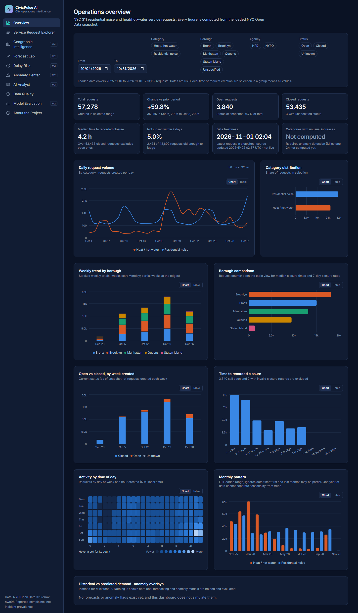
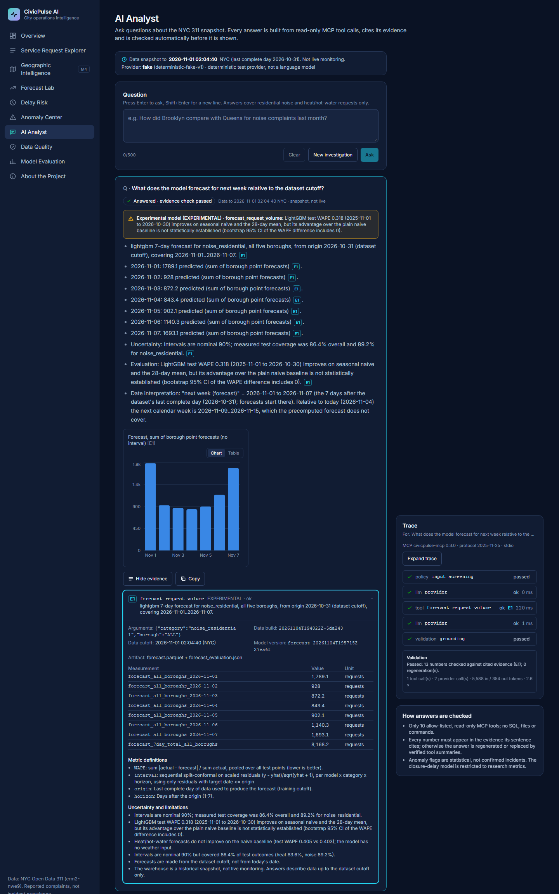

# CivicPulse AI: predictive city operations intelligence

A personal engineering project. It is an end-to-end analytics platform on **real NYC 311 service
requests** (residential noise, heat/hot water). It is built in milestones, and only what is
listed as done below has been implemented and verified.

> **Status: Milestone 5 (deployment preparation) awaiting review.** Milestones 1–4 are merged. The
> deployment path is implemented and verified in a production-like local Docker staging: pinned snapshot
> artifacts, a server-side proxy and a proxy-only API. **No cloud environment is deployed.** The AI analyst runs
> only in deterministic demonstration mode, and no real LLM has been run through it. See
> [`docs/PROJECT_STATUS.md`](docs/PROJECT_STATUS.md).



## The problem
City analysts need to know where service-request volume is rising, how quickly requests get
closed, and whether the data behind those answers can be trusted. 311 data is public but
large, changing daily, and full of quirks: bulk record rewrites, invalid closures, missing
coordinates, and reporting bias. This project builds a pipeline and dashboard that handle
those quirks explicitly.

## What works today (verified)
- **Ingestion** from the Socrata API, verified live:
  - keyset pagination on `:id` and explicit `$select`
  - server-side filters
  - retries with exponential backoff, jitter and `Retry-After`
  - checkpoint/resume, a forward-only watermark with a 72 h lookback, a failed-batch log, and lineage
- **Warehouse:** DuckDB over Parquet.
  - Deterministic rebuild with dedup to the latest version per request.
  - Structural failures are quarantined; plausibility problems are flagged and excluded only
    from the affected measure.
  - 30 data-quality rules with run history.
- **Analytics API** (FastAPI, read-only): KPIs with documented definitions, time series,
  breakdowns, closure distribution, hourly pattern, request search, drill-down and bounded
  CSV export.
- **Dashboard** (Next.js + Recharts): Overview, Service Request Explorer, Data Quality and
  About. It has URL-backed filters shared by every component, a table view for every chart,
  and loading, error and empty states. It works on mobile.

- **Predictive models (Milestone 2)**, trained by `civicpulse-model train` and served read-only
  from precomputed outputs:
  - **7-day daily forecasts** per borough × category: naive, seasonal-naive, 28-day mean and
    LightGBM, with rolling-origin backtests and conformal 90% intervals.
  - **Closure-delay risk** (not closed within 7 days): majority class, logistic regression and
    LightGBM, using creation-time features only, with label-maturity cutoffs.
  - **Anomaly detection**: a seasonal robust z-score, evaluated with synthetic injected anomalies.
  - The **Prediction Lab** pages (Forecasts, Delay Risk, Anomalies, Model Evaluation) show real
    model output and backtest metrics. They show no illustrative numbers.

- **MCP server + AI analyst (Milestone 3)**:
  - `civicpulse-mcp`: a real MCP server (official Python SDK) with 10 typed, read-only tools
    (trends, borough comparison, breakdowns, forecast, restricted closure-delay research summary,
    anomaly flags, explanations, data quality, model evaluation, investigation report). Every
    result carries provenance, coverage, uncertainty and limitations. No SQL, file or shell tools.
  - An orchestrator that validates every tool call against the server's schemas, enforces tool,
    token, time and cost budgets, assigns evidence IDs, and **checks every number in an answer
    against the evidence it cites**. It regenerates once, then falls back to verified tool summaries.
  - The **AI Analyst** page shows the answer with clickable evidence, charts, a freshness indicator,
    the full tool trace and model warnings. Closure-delay predictions are disabled for the agent
    after the [AI readiness audit](docs/evaluation/AI_READINESS_AUDIT.md).
  - 60 deterministic evaluation scenarios: 60/60 with the fake provider
    ([`AGENT_EVAL.md`](docs/evaluation/AGENT_EVAL.md)). These results test the controls, not LLM quality.



### Model results (test periods, real data; full detail in [`docs/evaluation/MODEL_EVALUATION.md`](docs/evaluation/MODEL_EVALUATION.md))
| Task | Selected (on validation) | Test result | Honest reading |
|---|---|---|---|
| 7-day forecast, 52 weekly origins, Nov 2025 → Oct 2026 | LightGBM | WAPE 0.318 vs seasonal-naive 0.368, naive 0.347 | Beats seasonal-naive and 28-day mean (bootstrap CIs exclude 0). **Not significantly better than naive.** No gain on heat. 90% intervals cover 86.4%. |
| Delay risk, Jan → Oct 2026, 544,834 requests | LightGBM | PR-AUC 0.062 (base rate 0.027), ROC-AUC 0.79 | Ranks mostly by category and borough. Chance-level within a category. **Poorly calibrated** under 2026 label drift. Not decision-grade. |
| Anomalies, 144 synthetic injections | seasonal MAD | recall 29.9% at a 7.7% alert rate on ordinary days | Catches about half of +100% spikes and few changes under 50%. Real alerts are unverified. |

### Real data loaded (local snapshot)
| | |
|---|---|
| Source | NYC Open Data `erm2-nwe9`, *311 Service Requests from 2020 to Present* |
| Scope | `Noise - Residential` (NYPD), `HEAT/HOT WATER` (HPD) |
| Window | created **2023-01-01** → 2026-11-01 02:04 (NYC local); 7 contiguous backfill windows, each re-counted live ([manifest](docs/data/MANIFEST.md)) |
| Records | **2,511,293** accepted, 0 rejected (2,975,048 raw rows incl. 463,755 superseded versions) |
| Quality | 29 of 31 rules pass or are informational. 2 warnings (DQ040, DQ042): the source has published no row newer than 2026-11-02 02:38 UTC. |
| Freshness | Snapshot, **not live**. Timestamps are shown in the UI. |

### Measured performance (Milestone 1: local Windows laptop, 773k rows, via the web proxy)
KPI query 72–80 ms cold / ~5 ms cached. Uncached explorer search ~52 ms. 10,000-row CSV export
~220 ms. Warehouse rebuild ~4 s. Full 12-month extraction ~5.5 min (no app token).

## Architecture
```text
Socrata API → ingestion (raw Parquet + run state) → DuckDB transform → Parquet warehouse
            → analytics service (shared by the REST API and the MCP tools) → FastAPI → Next.js
warehouse → civicpulse-model train → data/models/runs/<id>/ (predictions, backtests, evaluation)
            → prediction service (read-only) → FastAPI /api/v1/predictions, /models, /anomalies
/analyst → POST /api/v1/ai/investigations → orchestrator (provider, policy, grounding)
            → MCP client ⇄ civicpulse-mcp (stdio subprocess) → analytics + prediction services
```
MCP details: [`docs/mcp/ARCHITECTURE.md`](docs/mcp/ARCHITECTURE.md) · [tools](docs/mcp/TOOLS.md) ·
[protocol verification](docs/mcp/PROTOCOL_VERIFICATION.md) · [AI threat model](docs/security/AI_THREAT_MODEL.md).
Details and the architecture decision record: [`docs/architecture/SYSTEM_DESIGN.md`](docs/architecture/SYSTEM_DESIGN.md).

## Quick start
```bash
py -3.12 -m venv .venv && .venv/Scripts/python -m pip install -e ".[dev,ml]"   # Python 3.11+
cd apps/web && npm ci && cd ../..

.venv/Scripts/civicpulse extract --mode backfill   # last 12 months, ~5 min (or see offline option below)
bash scripts/backfill_history.sh                   # optional: history back to 2023-01-01, ~20 min, resumable
.venv/Scripts/civicpulse build
.venv/Scripts/civicpulse-model train               # forecasts, delay risk, anomalies (~9 min on full history)
.venv/Scripts/python -m uvicorn civicpulse_api.main:app --port 8000
cd apps/web && npx next build && npx next start -p 3000          # open http://localhost:3000
```
The AI analyst works out of the box with the deterministic fake provider (`CIVICPULSE_LLM_PROVIDER=fake`,
no key, no network). To use an OpenAI-compatible model, set `CIVICPULSE_LLM_PROVIDER=openai`,
`CIVICPULSE_LLM_MODEL` and `CIVICPULSE_OPENAI_API_KEY` in your local `.env` (server-side only; see
`.env.example`). Run the MCP server on its own with `civicpulse-mcp` (stdio) for any MCP client.

Offline: `python scripts/build_sample_warehouse.py --data-dir .sample-data --with-models` and set
`CIVICPULSE_DATA_DIR=.sample-data`. This uses 3,785 committed real records (2023-01 → 2026-11)
and trains smoke-scale models whose metrics are **not** meaningful. See
[`data/samples/README.md`](data/samples/README.md).

Other commands: `civicpulse extract --mode incremental`, `civicpulse status`,
`civicpulse duckdb` (writes a `.duckdb` file of views for ad-hoc SQL), and `make help`-style
targets in the `Makefile`.

## MCP server
`civicpulse-mcp` is a standard MCP server (official Python SDK, `mcp` 2.3) over the same warehouse:
```bash
.venv/Scripts/civicpulse-mcp                         # stdio (default) — for any MCP client
CIVICPULSE_MCP_HTTP_TOKEN=<32+ random chars> .venv/Scripts/civicpulse-mcp --transport streamable-http
                                                     # loopback 127.0.0.1:8765 only, bearer token required
```
It needs a built warehouse (`CIVICPULSE_DATA_DIR`). Tools, arguments and result envelope:
[`docs/mcp/TOOLS.md`](docs/mcp/TOOLS.md). Protocol checks: [`docs/mcp/PROTOCOL_VERIFICATION.md`](docs/mcp/PROTOCOL_VERIFICATION.md).

## AI Analyst
Open `http://localhost:3000/analyst` with the API and web running. By default the analyst uses the
**deterministic fake provider**: a rule-based stand-in that is *not* a language model. It needs no
key, makes no network calls, and is labelled as such in the UI. Every answer shows its evidence
(E1…), the MCP tool trace, data freshness and model warnings.

The UI shows **"Demonstration Mode — deterministic analytical assistant, not a live LLM."** whenever the
fake provider is active. Every number in an answer is a structured claim validated against MCP evidence
([semantic grounding](docs/evaluation/SEMANTIC_GROUNDING.md)); answers can be exported as Markdown, print HTML or a
checksummed JSON report that `python -m civicpulse_agent.report verify` re-validates offline.

> **Real-LLM integration has not been verified.** An OpenAI-compatible provider is implemented but tested only
> against mocked HTTP. Paid use is off by default and fails closed: it needs `CIVICPULSE_LLM_PROVIDER=openai`,
> `CIVICPULSE_AI_PAID_ENABLED=true`, an API key, `CIVICPULSE_AI_ACCESS_TOKEN`, a positive daily budget and both
> token prices (all server-side, see `.env.example`). `scripts/llm_smoke_test.py` runs one bounded paid
> investigation only with explicit authorization; it has not been run.

## Geographic Intelligence
`/geo` maps borough-level 311 counts on NYC DCP borough boundaries (MapLibre, no basemap tiles, no addresses or
point locations), with volume and period-over-period change modes, a sortable ranking table, borough detail with
trend and comparison, and interpretation caveats (reports are not incidents; raw counts are not rates).

## Tests
```bash
.venv/Scripts/python -m pytest                 # 344 offline tests (ingestion, analytics, modeling, API, MCP, agent)
.venv/Scripts/python -m pytest -m live         # opt-in checks against the real API
cd apps/web && npx playwright test             # 48 browser tests incl. geo, AI Analyst, axe accessibility, mobile
cd apps/web && npm run test:unit               # analyst helper unit tests (node:test)
.venv/Scripts/python scripts/agent_eval.py     # 70 agent scenarios via real stdio MCP (fake provider)
.venv/Scripts/python scripts/mcp_benchmark.py  # MCP latency/memory benchmark (real stdio subprocesses)
```
Analytics tests compare every metric with an **independent Polars computation** over a
warehouse built from the committed real sample. Ingestion tests use a fake Socrata server that
reproduces the real API's quirks: non-lexicographic `:id` order, omitted nulls, 429s and timeouts.

## Data source, attribution and limitations
Data from **NYC Open Data**, published by the NYC Office of Technology and Innovation. This
project filters, cleans and aggregates it; it is not an official City product, and the City
gives no warranty of accuracy.
- 311 records **reported complaints**, not true incident prevalence. Reporting propensity varies
  between neighborhoods ([research](docs/research/SOURCES.md#2-analytical-validity-and-known-biases)).
- "Time to closure" is time to a **recorded** closure. The median excludes open requests.
- Street addresses are never ingested, and coordinates are never served.
- Model scores are associations learned from historical data. They are not causal claims and
  not operational recommendations. The delay-risk model is weak and poorly calibrated on 2026
  data (see its doc).

## License
The NYC 311 data is published by the City of New York on NYC Open Data. Its dataset page and
metadata (`erm2-nwe9`, checked 2026-11-04) state no explicit license, and the City provides it
"as is". The committed sample (`data/samples/`, 3,785 rows, coordinates rounded to about 100 m, no
street addresses) is a filtered, modified extract, redistributed with attribution for testing only.
The source code is released under the [MIT License](LICENSE); the license does not cover the NYC data.

## Documentation
[Sources and research](docs/research/SOURCES.md) · [System design and ADR](docs/architecture/SYSTEM_DESIGN.md) ·
[Data dictionary](docs/data/DATA_DICTIONARY.md) · [Quality rules](docs/data/QUALITY_RULES.md) ·
[Data manifest](docs/data/MANIFEST.md) · [Deployment](docs/deployment/DEPLOYMENT.md) · [Project status](docs/PROJECT_STATUS.md)

Modeling: [Forecasting](docs/modeling/FORECASTING.md) · [Delay risk](docs/modeling/DELAY_RISK.md) ·
[Anomalies](docs/modeling/ANOMALIES.md) · [Model evaluation](docs/evaluation/MODEL_EVALUATION.md)

AI: [AI readiness audit](docs/evaluation/AI_READINESS_AUDIT.md) · [Agent evaluation](docs/evaluation/AGENT_EVAL.md) ·
[MCP architecture](docs/mcp/ARCHITECTURE.md) · [AI threat model](docs/security/AI_THREAT_MODEL.md) ·
[Semantic grounding](docs/evaluation/SEMANTIC_GROUNDING.md) · [MCP benchmarks](docs/performance/MCP_BENCHMARKS.md) ·
[Deployment readiness](docs/deployment/DEPLOYMENT_READINESS.md) · [Borough boundaries provenance](docs/data/borough_boundaries.json)
Deployment (M5): [Hosting decision](docs/deployment/HOSTING_DECISION.md) · [Cost](docs/deployment/COST_ESTIMATE.md) ·
[Architecture](docs/deployment/ARCHITECTURE.md) · [Artifacts](docs/deployment/ARTIFACT_MANIFEST.md) ·
[Environment](docs/deployment/ENVIRONMENT_VARIABLES.md) · [Staging verification](docs/deployment/STAGING_VERIFICATION.md) ·
[Production checklist](docs/deployment/PRODUCTION_CHECKLIST.md) · [Platform setup](docs/deployment/PLATFORM_SETUP.md) · [Rollback](docs/deployment/ROLLBACK.md)
